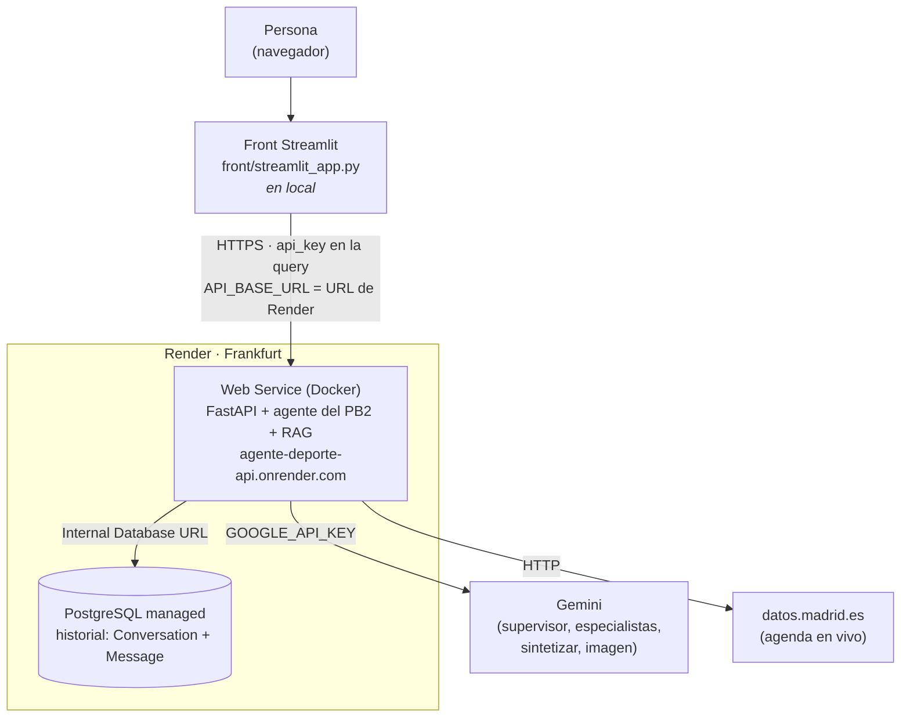

# Informe de decisiones — Project Break 3 (MLOps)

El agente del PB2 (multiagente LangGraph + RAG del PB1 sobre el deporte municipal de Madrid), publicado como servicio:
API FastAPI con Swagger, historial en PostgreSQL, una imagen Docker desplegada en Render y un front Streamlit que habla con la URL pública.

**URL del servicio:** https://agente-deporte-api.onrender.com (`/docs` y `/health` públicos; la API key de demo va por el canal de entrega)

| Apartado | Responsable |
|---|---|
| 1. Sistema desplegado | Davide |
| 2. Contrato | Alex |
| 3. Datos | María |
| 4. Prueba de vida | Davide |
| 5. Arquitectura y coste | Entre todos |
| 6. CI/CD | Entre todos |
| 7. Tres fallos | Uno cada uno |

---

## 1. Sistema desplegado

- **Front (local):** solo habla HTTP con la API, a través de `front/api_cliente.py`. No importa el grafo, ni `config.py`, ni nada de `src/` (hay un test que lo comprueba).
- **Web Service (Render):** una sola imagen Docker con la API, el agente, las tools y el índice del RAG ya construido.
- **PostgreSQL (Render):** guarda el historial de los turnos cerrados. Vive fuera del contenedor, así que sobrevive a reinicios y redeploys. El servicio y la base están en la misma región, y se hablan por la *Internal Database URL*, sin salir a internet.
- **Gemini y datos.madrid.es:** los únicos servicios externos. La clave de Gemini está en el panel de Render.
- **Lo que no sale del proceso:** el checkpoint del grafo (`MemorySaver`). Un reinicio pierde un HITL a medias, pero no el historial (apartado 3).

## 2. Contrato: qué es público y qué lleva `api_key`

<!-- Rutas públicas (/health, /docs) y protegidas (/ask, /approve, /threads/{id}/messages); 401, 422, 429, 503 y 504. -->

_Pendiente._

## 3. Datos: qué hay en Postgres y qué se pierde al reiniciar

### Qué guardamos en PostgreSQL

El historial de los turnos cerrados, con SQLModel (`src/models.py` y `src/db.py`). Las tablas se crean al arrancar la API.

| Tabla | Columnas | Contenido |
|---|---|---|
| `conversation` | `id` (= `thread_id`), `created_at` | Una fila por conversación |
| `message` | `id` autoincremental, `thread_id` → `conversation.id`, `role`, `content`, `created_at` (UTC) | Dos filas por turno: la pregunta (`user`) y la respuesta (`assistant`) |

- **Qué es un turno cerrado:** aprobado, rechazado o sin plan. Un turno con el plan pendiente se guarda cuando se decide en `/approve`; si el agente devuelve `error`, no se guarda nada.
- **Una transacción por turno:** se guardan los dos mensajes o ninguno.
- **Orden por `id`, no por fecha:** la pregunta y la respuesta se guardan a la vez y pueden tener el mismo `created_at`.
- **Conexión:** `DATABASE_URL` sale del entorno (`.env` en local y panel de Render en la nube). `config.py` convierte el `postgres://` que da Render en `postgresql+psycopg://`. En local usamos un contenedor `postgres:16` con volumen; en Render, el Postgres gestionado.

### Qué vive solo en la memoria del proceso

- **El estado del grafo** (`MemorySaver`, por `thread_id`) y **los planes pendientes de aprobar** que guarda la API. Si el servicio se reinicia o se redespliega con un plan pendiente, ese plan se pierde: `/approve` devuelve 404 y hay que repetir la pregunta. **El historial de los turnos cerrados no se pierde.** Llevar el checkpoint de LangGraph a Postgres queda fuera del alcance del enunciado.
- **El archivo del plan aprobado** (`salidas/plan_….md`) se escribe en el disco del contenedor. Lo comprobamos en local: se crea dentro del contenedor y desaparece al pararlo. En Render pasa lo mismo en cada redeploy (ver apartado 7).

### Cómo lo hemos comprobado

- **Tests contra Postgres real** (`tests/test_db_postgres.py`): orden de los mensajes, dos `thread_id` que no se mezclan, y el historial tras cerrar todas las conexiones y abrir una nueva (como un proceso recién arrancado). Se saltan si Postgres no responde en 2 s, para no bloquear el CI. Los tests de las rutas usan una base de prueba en memoria; el servicio usa siempre Postgres.
- **Reinicio de la API en local:** un turno guardado desde uvicorn sigue ahí después de reiniciarlo, y el contenedor Docker lee los mismos mensajes del mismo Postgres.
- **Desde el front:** turno, reinicio de la API, «Recargar historial» y «Abrir una conversación» → el turno reaparece.
- **En la URL pública:** ver apartado 4.

### Una decisión que salió de un fallo real

Sin límite de espera, con Postgres caído, la conexión se quedó colgada **3 min 26 s** sin dar error. Con `connect_timeout=10` falla en **unos 22 s** (un intento por IPv6 y otro por IPv4) con un error claro, en vez de dejar la API colgada.

## 4. Prueba de vida

**URL enviada al profesorado:** https://agente-deporte-api.onrender.com

Hecha el 23/11/2026 desde el front, con `API_BASE_URL` apuntando a la URL de Render:

| Hora | Paso | Evidencia |
|---|---|---|
| 17:08 | Pregunta y **Aprobar** en el front (`thread_id = cb3d1306`). El turno queda cerrado y guardado | [`pb3_01_turno_aprobado.png`](capturas/pb3_01_turno_aprobado.png) |
| 17:11 | **Reinicio del servicio** en Render («Service restarted by you») | [`pb3_02_render_events_reinicio.png`](capturas/pb3_02_render_events_reinicio.png) |
| 17:14 | Front recargado desde cero (`ultimo: null`), **Abrir una conversación** `cb3d1306`: el turno sigue ahí, leído de Postgres | [`pb3_03_historial_tras_reinicio.png`](capturas/pb3_03_historial_tras_reinicio.png) |

Además, en la URL pública `/health` devuelve `{"status":"ok","storage":"postgres"}` ([`pb3_04_health_render.png`](capturas/pb3_04_health_render.png)) y `/docs` abre sin clave ([`pb3_05_docs_render.png`](capturas/pb3_05_docs_render.png)). El servicio y la base, en el mismo proyecto de Render: [`pb3_06_render_proyecto.png`](capturas/pb3_06_render_proyecto.png).

Cómo repetirla:
1. Hacer un turno en el front y anotar el `thread_id`.
2. En Render, **Manual Deploy → Restart service** (o un redeploy).
3. En el front, **Recargar historial**, o, tras recargar la página, **Abrir una conversación** con ese `thread_id`. Sin front vale lo mismo con `GET /threads/{thread_id}/messages?api_key=…` en Swagger.

_Se repetirá con el agente real tras el despliegue final desde `main`, y se actualizarán horas y capturas._

## 5. Conclusiones de arquitectura y coste

### Piezas y por qué la API va en un solo contenedor

_Pendiente._

### Un límite que hemos notado de verdad

**La memoria RAM del plan gratuito de Render (512 MB).** Nuestro RAG calcula los embeddings con un modelo
local (`paraphrase-multilingual-MiniLM-L12-v2`, con torch). Lo medimos dentro de la imagen Docker:

| Medida | Memoria |
|---|---|
| API + agente + Chroma, sin el modelo del RAG | 158 MB |
| + importar torch y sentence-transformers | 583 MB |
| + cargar el modelo y hacer una búsqueda | unos 1000 MB (pico) |
| Con 512 MB y sin swap (`--memory=512m --memory-swap=512m`, como el plan gratuito) | El contenedor muere al cargar el modelo (exit 137, falta de memoria) |
| Con 2 GB (plan Standard) y un `/ask` real del agente | 880 MiB (43 %) |

Con solo `--memory=512m` la prueba engaña: Docker permite otro tanto de swap (disco usado como memoria) y el
proceso sobrevive. Render no tiene swap, así que hay que medir con `--memory-swap` igual a `--memory`.

**Efecto en la demo:** con el plan gratuito, el servicio se caería en la primera pregunta que usara el RAG.
Planteamos tres salidas en el issue #4: subir al plan Standard (2 GB), calcular los embeddings con la API de
Gemini (lo probamos: la cuota gratuita cuenta por texto, 1.000 al día, y no da para indexar los 1.714 chunks
en un día) o pasar a una búsqueda por palabras clave (perdería la búsqueda semántica del PB1). Elegimos el plan
Standard. En clase no aparecía este límite porque el RAG de la Live Review era léxico, sin modelo.

### Escalado

<!-- Primer paso si hubiera más usuarios (subir plan) y qué no montamos (varias réplicas, colas). -->

_Pendiente._

### Dos facturas: infraestructura y tokens

<!-- Orden de magnitud: web + Postgres en Render, y tokens de un /ask. -->

**Infraestructura (Render):**

| Pieza | Plan | Coste |
|---|---|---|
| Web Service (API + agente + RAG) | Standard: 1 CPU, 2 GB | 25 $/mes, prorrateado por segundos |
| PostgreSQL | Gratuito: 256 MB | 0 $ (caduca a los 30 días; suficiente para la entrega y la presentación) |

Desde el despliegue hasta la presentación son unos 10 días: **del orden de 8–9 $**, repartidos entre los tres.
Después de la presentación el servicio vuelve al plan gratuito. Para dejar de pagar hay que bajar la máquina o
borrar el servicio; cambiar el plan del espacio de trabajo no basta.

**Tokens de un `/ask`:** _pendiente_

## 6. Conclusiones de CI/CD

### Qué comprobaríamos antes de cada deploy

<!-- Un test que no llama al LLM y un docker build. -->

1. **Tests que no llaman al LLM:** `python -m pytest -q` (82 tests). El agente y la API se sustituyen por
   versiones falsas, así que no hace falta clave ni red. Los tests contra Postgres real se saltan si no hay
   Postgres. GitHub Actions ya los ejecuta en cada push y en cada PR (`.github/workflows/tests.yml`), y una
   PR no se mergea sin ellos en verde.
2. **Un `docker build`:** comprueba que la imagen se construye (dependencias, torch e índice del RAG) antes de
   que lo intente Render. Tarda unos 10 minutos la primera vez o si cambia la imagen base `python:3.12-slim`;
   con caché y cambios solo de código, segundos. Después, un `docker run` y `GET /health` →
   `"storage": "postgres"`. Este paso no está en el CI; añadirlo como job sería el siguiente paso.

### Dónde están los secretos

- **En local:** en el `.env`, que está en `.gitignore` (no se sube) y en `.dockerignore` (no entra en la imagen).
  El contenedor los recibe al arrancar con `--env-file .env`. En el repo solo está `.env.example`, sin valores reales.
- **En Render:** en las variables de entorno del panel del servicio (`DATABASE_URL`, `GOOGLE_API_KEY`, `API_KEY`…).
- **Fuera de los logs:** uvicorn arranca con `--no-access-log` porque la `api_key` va en la URL (`?api_key=…`) y
  el log de accesos la escribiría. Los logs propios de la API no incluyen claves ni la `DATABASE_URL`.

### Cómo desplegamos y qué es un rollback

- **Cómo desplegamos:** Render construye la imagen con nuestro `Dockerfile` y la arranca con las variables del panel. Para la entrega, el servicio despliega la rama `main`: se llega a ella solo desde `develop` y con PR, así que lo que está en producción siempre ha pasado los tests y una revisión. El objetivo es que cada merge a `main` redespliegue solo (ver el fallo 2); mientras tanto, se lanza con **Manual Deploy**.
- **Rollback:** en Render, **Deploys → un deploy anterior → Rollback**. Vuelve a la imagen anterior en un par de minutos, sin tocar Git. Después se corrige en una rama y se vuelve a mergear a `main` (o se hace `git revert` en `main`). El historial no se toca, porque está en Postgres y no en la imagen.

### Qué separa desarrollo de producción

Lo que cambia son las variables, no el código:

| | Desarrollo (local) | Producción (Render) |
|---|---|---|
| Dónde están las variables | `.env` | panel del servicio |
| API | `uvicorn app:app --reload` en `127.0.0.1:8000` | la imagen Docker, en el `PORT` que inyecta Render |
| Base de datos | Postgres en Docker local o la *External Database URL* de Render | la *Internal Database URL* (misma región) |
| `API_KEY` | una clave de pruebas | otra distinta, que solo se comparte con el profesorado |
| Front | `API_BASE_URL=http://127.0.0.1:8000` | `API_BASE_URL=https://agente-deporte-api.onrender.com` |

## 7. Tres fallos y qué haríamos después

1. **El plan aprobado se pierde en cada redeploy** (María). Al aprobar un plan, el agente lo escribe en
   `salidas/plan_….md`, en el disco del contenedor. Ese disco es temporal: lo comprobamos en local (el archivo
   se crea dentro del contenedor y desaparece al pararlo) y en Render se borra en cada despliegue. El historial
   de la conversación no se pierde porque va a Postgres; el archivo del plan, sí.
   **Qué haríamos:** guardar el plan aprobado en Postgres, en una tabla `Plan` (`thread_id`, pasos y fecha),
   igual que el historial. Lo señaló Davide en la revisión de la PR #7.

2. **El auto-deploy no se pudo conectar desde la cuenta de Render del equipo** (Davide). El servicio de Render
   está en mi cuenta, pero el repo está en la de Alex. Render solo ve los repos de las cuentas donde se instala su
   app de GitHub, y esa app solo la puede instalar el dueño de la cuenta. Por eso el servicio quedó conectado como
   **repositorio público**: despliega bien, pero no redespliega solo con cada push a `main`.
   **Qué haríamos:** que el dueño del repo autorice la app de Render, o usar un *deploy hook* de Render (una URL
   secreta) llamado desde GitHub Actions en cada push a `main`, después de que pasen los tests. Y, desde el primer
   día, tener el repo y el servicio de despliegue en la misma cuenta u organización.

3. _Pendiente._
